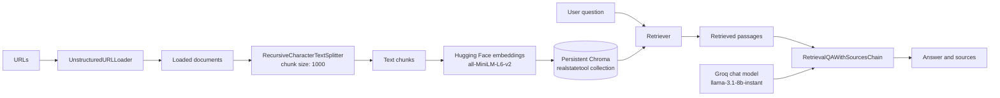

<div align="center">


# 🏡 Real Estate Research Assistant


**A source-grounded question-answering project using retrieval-augmented generation (RAG).**

Collect web pages, index their content locally, and ask questions over retrieved passages.

</div>


> **Quick path:** install dependencies → configure Groq credentials → index URLs → ask questions and inspect the returned sources.

**Contents:** [Overview](#-overview) · [Architecture](#️-architecture) · [Setup](#️-setup) · [Project layout](#-project-layout) · [Limitations](#-limitations)

## 📌 Overview

This project turns supplied web pages into a searchable knowledge base, then answers questions using relevant retrieved passages. Its RAG workflow is implemented in `rag.py`:

1. Initialize a Groq chat model and Hugging Face embedding model.
2. Load web pages with `UnstructuredURLLoader`.
3. Split their text into chunks of up to 1,000 characters.
4. Embed and store the chunks in a persistent Chroma collection.
5. Retrieve relevant chunks and ask the language model to answer with sources.

The answer is intended to be grounded in the indexed pages; response quality depends on the source pages, retrieval, and model.

## 🏗️ Architecture



### Main components

| Component | Responsibility |
|---|---|
| URL loader | Fetches and parses the provided web pages. |
| Recursive text splitter | Creates overlapping/context-friendly document chunks (the code sets chunk size to 1,000; overlap uses the splitter default). |
| Hugging Face embeddings | Converts text into vectors using `sentence-transformers/all-MiniLM-L6-v2`. |
| Chroma | Stores vectors in `resources/vectorstore` under the `realstatetool` collection. |
| Retriever and QA chain | Finds relevant chunks and passes them to the Groq chat model for a sourced answer. |

## 🔄 Step-by-step flow

### Indexing pages

`process_urls(urls)` reports progress as it works. It initializes shared components, resets the collection, loads the URLs, splits loaded documents, assigns UUIDs, and inserts the resulting chunks into Chroma. Resetting means each indexing run replaces the collection's existing contents rather than appending to them.

### Asking a question

`generate_answer(query)` checks that the vector store is initialized, initializes the model if necessary, creates a `RetrievalQAWithSourcesChain`, and invokes it with the question. It returns a pair: the answer and the source information returned by the chain.

### Data lifecycle

```text
Web pages → parsed documents → chunks → embeddings → persistent Chroma
Question → relevant chunks + question → Groq model → answer + sources
```

## ⚙️ Setup

1. Install the project dependencies:

   ```bash
   pip install -r requirements.txt
   ```

2. Configure the Groq credential expected by your installed LangChain/Groq integration. The `rag.py` helper loads `KEY=VALUE` entries from a `.env` file beside the script and adds them to the environment if they are not already set. Use the exact variable name expected by the integration. **Do not commit API keys.**

3. Use the project's application entry point to provide URLs for indexing and submit questions. The UI/CLI invocation depends on the contents of `main.py`.

The embedding model may need to be downloaded on first use. The persistent vector store is created at `resources/vectorstore` relative to `rag.py`.

### First-run checklist

- Run commands from the project environment where the requirements are installed.
- Ensure the machine can access the supplied pages and download the embedding model on first use.
- Confirm the process has permission to create or update `resources/vectorstore`.
- Index pages before submitting questions so the retriever has content to search.

## 📁 Project layout

```text
Real Estate Tool/
├── main.py                  # Application entry point (see project source)
├── rag.py                   # URL ingestion, indexing, retrieval, and answers
├── requirements.txt         # Python dependencies
├── Documentloader.ipynb     # Document-loader exploration
├── 2.Text_Splitter.ipynb     # Text-splitting exploration
└── resources/
	└── vectorstore/         # Persistent Chroma data, created at runtime
```

The notebooks are useful for learning and experimentation; the production-style RAG functions shown here are in `rag.py`.

## 📈 Performance notes

Let **T** be the total number of characters loaded, **N** the number of resulting chunks, **D** the embedding dimension, and **K** the number of retrieved chunks.

| Stage | Approximate cost | Notes |
|---|---:|---|
| Fetch and parse pages | Depends on page/network size | Network latency and page complexity often dominate. |
| Split documents | O(T) | Each character is processed a small number of times; chunk size affects N. |
| Embed and index | O(N × embedding cost) | Typically the most expensive indexing step; model inference and storage are additional costs. |
| Vector retrieval | Often sublinear in N with an ANN index; implementation-dependent | Exact search can be O(N × D); Chroma's index/configuration determines actual behavior. |
| Generate answer | Depends on prompt/context tokens and model | Latency and token usage grow with the retrieved context and answer length. |

The current code uses a fixed chunk size, resets the collection on every `process_urls` run, and has no explicit URL validation, retry policy, or empty-result handling. Large or unreliable pages may therefore take time or fail during loading/indexing. Only index sources you are authorized to access, and treat retrieved web content as untrusted input.

## ⚠️ Limitations

- Answers depend on the text extracted from pages and the passages retrieved; verify important facts against the original sources.
- Each indexing run replaces the existing collection rather than appending to it.
- Page structure, network availability, model output, and dependency versions can all affect results.
- This learning project is not a substitute for professional real-estate, legal, or financial advice.

## 🔐 Configuration and maintenance notes

- `CHUNK_SIZE`: currently `1000` characters.
- `EMBEEDING_MODEL`: currently `sentence-transformers/all-MiniLM-L6-v2` (the variable name is spelled this way in the code).
- `COLLECTION_NAME`: currently `realstatetool`.
- `VECTORSTORE_DIR`: `resources/vectorstore` beside `rag.py`.
- The Groq model is configured in `initialize_components()` as `llama-3.1-8b-instant` with temperature `0.2` and a 300-token limit.
- Keep credentials in environment variables or an ignored local `.env` file; never place secrets in source control.

## 🧭 Scope

This README describes the RAG implementation visible in `rag.py`. The exact UI, invocation command, and dependency versions should be confirmed against `main.py` and `requirements.txt` in the repository. Contributions that improve setup clarity, ingestion reliability, or source verification are welcome.

---

<div align="center">


*Built for exploring real-estate information with retrieval-augmented generation* 🏠

</div>
